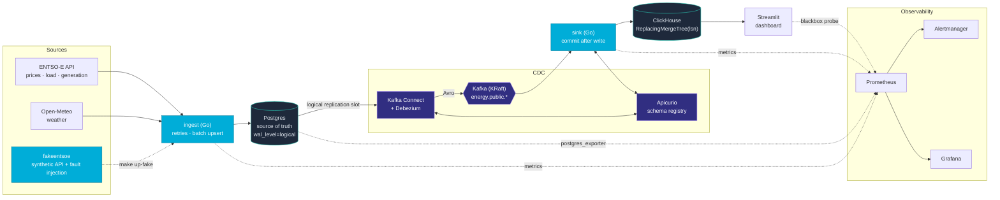

# Energy Data Platform

A data platform for the European electricity market. A Go service ingests ENTSO-E (prices, load, generation) and Open-Meteo weather into Postgres. Debezium on Kafka Connect streams the changes into Kafka, and a Go sink loads them into an analytical store. The focus is on platform engineering: delivery guarantees, observability, and failure handling.

> Work in progress. Design decisions are in [`docs/adr/`](docs/adr/).

## Architecture



ENTSO-E revises published values after the fact, so the source produces real `UPDATE`s, not just appends. That is what makes CDC meaningful here:

- **Ingest** upserts each batch into a current-state table. Re-fetching a window is idempotent.
- **Debezium** reads the Postgres WAL and publishes every change as an Avro event, with the LSN attached.
- **Sink** writes to ClickHouse first and commits the Kafka offset after. Delivery is at-least-once, and duplicates collapse in `ReplacingMergeTree` by LSN, so `FINAL` matches Postgres ([ADR 0026](docs/adr/0026-at-least-once-with-idempotent-sink.md)).
- **Observability** covers ingestion freshness, replication slot state and WAL retention, and sink consumer lag. Alert rules are unit-tested with promtool, and the main failure scenarios have runbooks in [`docs/runbooks/`](docs/runbooks/).

## Quickstart (local)

```bash
cp .env.example .env   # fill in API tokens
make up                # Postgres, Kafka (KRaft), Kafka Connect + Debezium, Apicurio, ClickHouse, ingest, sink, dashboard, Prometheus, Grafana
make ps
make test lint
```

| Service | URL |
|---|---|
| Grafana | http://localhost:3000 |
| Prometheus | http://localhost:9090 |
| ingest (health, metrics) | http://localhost:8080/readyz, /metrics |
| Kafka (host) | localhost:9092 |
| Kafka Connect REST | http://localhost:8083/connectors |
| Apicurio Registry | http://localhost:8085 |
| ClickHouse | http://localhost:8123 (HTTP), localhost:9000 (native) |
| sink (health, metrics) | http://localhost:8082/readyz, /metrics |
| Dashboard (Streamlit) | http://localhost:8501 |
| Postgres | localhost:5432 |
| Alertmanager | http://localhost:9093 |

Grafana dashboards: Ingestion, CDC. Runbooks for failure scenarios are in [`docs/runbooks/`](docs/runbooks/).

### Without an ENTSO-E token

`make up-fake` starts the same stack against a synthetic ENTSO-E API (`cmd/fakeentsoe`, ADR 0021). It generates prices, load and generation for any window, with per-zone scale, shape, resolution and quirks calibrated from real data (ADR 0034), publishes them on the real schedule and revises past values over time. The stack runs as a separate compose project with its own volumes, so synthetic data never mixes with real data. Stop one stack before starting the other, because they share host ports.

```bash
make up-fake                        # no .env needed
make fault f='{"status":503}'       # every API request now fails; also "delay" and "retry_after"
make fault-clear
make down-fake
```

The fake API listens on http://localhost:8081.
